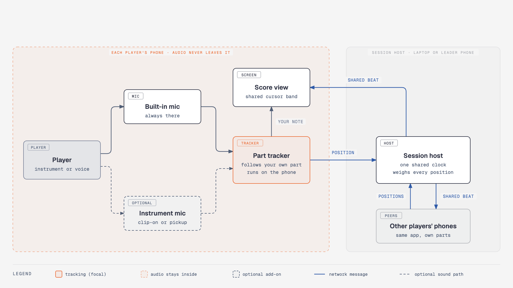
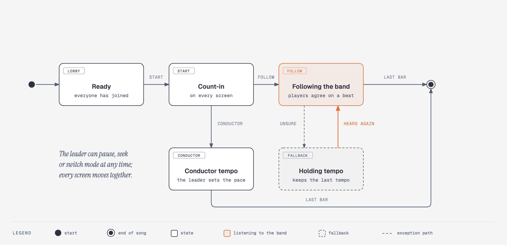

# Enzabeat

**The whole band, on the same bar.** Enzabeat is a phone app for musicians who read their parts from their phones while they play together. Every screen shows a moving cursor band, and every band points at the same place in the music at the same moment. Each phone listens to its own player, works out where that player is in their part, and shares only that position. The phones agree on one beat, so the cursor keeps the whole group together, and it keeps time even when it can't hear anyone.

This repository is the public design: architecture, what crosses the network, how the cursor behaves, and the decisions behind them. It contains no source code, and it deliberately leaves out the implementation detail that is the product's real work. See [What this repository leaves out](#what-this-repository-leaves-out).

> **Status.** In design. No app has been released, and nothing below describes shipped behaviour. [enzabeat.com](https://enzabeat.com/)

---

## Contents

- [System topology](#system-topology)
- [What crosses the network](#what-crosses-the-network)
- [Cursor modes](#cursor-modes)
- [How every screen shows the same moment](#how-every-screen-shows-the-same-moment)
- [Design decisions](#design-decisions)
- [What this repository leaves out](#what-this-repository-leaves-out)
- [Repository layout](#repository-layout)

---

## System topology

<p align="center">
  
</p>

<sub>Source: [`docs/diagrams/topology.html`](docs/diagrams/topology.html) · vector: [`topology.svg`](docs/diagrams/topology.svg)</sub>

Three pieces, and the only thing that travels between them is a position in the music:

- **Each player's phone** shows that player's own part and listens to them. The **built-in microphone** always works, with the phone on a music stand near its player. A **microphone or pickup mounted on the instrument** is an optional upgrade: it hears that player more clearly, and nothing requires it. A part tracker on the phone follows the player through *their own part*, note by note, and highlights the note they are playing right away, with no network involved.
- **The session host** runs on a laptop or on one of the phones, the "leader phone". It keeps a single clock that every phone synchronises to, combines the positions from all the players into one shared beat, and sends that beat back. It also hands out the score.
- **The other players' phones** do the same as yours, each following its own part.

One player losing their place, stopping for a rest, or dropping off the Wi-Fi doesn't stop the cursor. The rest of the band still carries it.

---

## What crosses the network

| Path | What crosses | What never does |
|---|---|---|
| **Player → their phone** | Sound, through the built-in microphone or an optional instrument microphone | — |
| **Phone → session host** | Where this phone thinks the band is in the score, and how sure it is | Audio, in any form |
| **Session host → every phone** | The shared clock, the shared beat, the score and the setlist | What any other phone heard |
| **Session → the internet** | Nothing, in a local session on one Wi-Fi network or hotspot | — |

Session recording is a planned, optional feature. If a band turns it on, each phone's own track goes to the band's own session host when the session ends. It is never streamed while the band is playing.

---

## Cursor modes

<p align="center">
  
</p>

<sub>Source: [`docs/diagrams/cursor-modes.html`](docs/diagrams/cursor-modes.html) · vector: [`cursor-modes.svg`](docs/diagrams/cursor-modes.svg)</sub>

- **Conductor tempo** needs no listening at all. The leader sets a tempo, everyone gets the same count-in, and the cursor moves at that pace on every screen. This alone covers the basic need, so it comes first.
- **Following the band** is the mode most songs use once listening works. The cursor follows the band as it plays: it speeds up, slows down, waits on a held note, and jumps when the band skips a repeat.
- **Holding tempo** is the fallback. When the phones can't tell where the band is (a quiet passage, an improvised solo, every player resting), the cursor carries on at the last tempo instead of freezing, and goes back to following the band when it hears the band again.

The leader can always pause, seek to a bar or switch mode, and every screen moves together.

---

## How every screen shows the same moment

Sending "we are at bar 24, beat 2" to every phone each time something changes would put Wi-Fi delay and jitter straight onto the screen: one phone would draw the cursor a little later than another, and the cursor would step rather than glide.

Instead, every phone keeps its clock in step with the session host's clock. The host sends occasional reference points, each saying where in the music the band was at a given moment on the shared clock and how fast it is moving. Every phone then draws the cursor itself, every frame, from the shared clock. Network delay changes how quickly a phone hears about a change, not where its cursor is, so side-by-side screens agree to within a few milliseconds.

The same approach means the host can move. A laptop, a leader phone, or a relay on the internet for players in different places all work the same way, because only small messages travel and none of them has to arrive at an exact moment.

---

## Design decisions

Recorded in [`docs/ARCHITECTURE.md`](docs/ARCHITECTURE.md). In brief:

- **Each phone follows its own player.** Tracking runs on the phone, against that player's own part, where the sound is clearest and the part is known.
- **Audio never leaves the phone.** Only positions travel. There is nothing to stream, buffer or leak.
- **One clock, one beat, drawn locally.** Phones agree on time first and draw the cursor themselves, so the network never sets the cursor's position on screen.
- **The built-in microphone is the baseline.** An instrument microphone makes tracking better. Nothing requires one.
- **Every player gets a vote, and the cursor never stops.** Positions are weighed by how sure each phone is. When nobody is sure, the cursor holds the tempo.
- **The leader always wins.** A manual seek, pause or tempo change overrides everything the phones hear.
- **Local first, and the host can move.** A laptop or a leader phone on the same Wi-Fi is the default. A relay on the internet is a later option.
- **Two native apps on one shared core,** following [Scribatic](https://github.com/niroshpg/scribatic): SwiftUI on iOS, Jetpack Compose on Android, and the listening and timing logic written once.
- **Public design, private implementation.**

---

## What this repository leaves out

This is a design document, not a recipe. Kept in the private implementation repository and out of here:

- source code, build configuration and release signing;
- how the part tracker listens and decides where a player is, including its features, models and tuning;
- how positions are weighed and combined, and every threshold and parameter behind the cursor's behaviour;
- the message formats, ports and timing protocol between the apps and the session host;
- evaluation recordings, measurements and accuracy targets;
- delivery plans, hosting details and infrastructure.

The behaviour described above is what the implementation is held to. The details are private because they are the work, not because the design depends on them staying secret.

To report a security issue, see [`SECURITY.md`](SECURITY.md).

---

## Repository layout

```
enzabeat-docs/
├── README.md                 This overview
├── SECURITY.md               How to report a vulnerability
└── docs/
    ├── ARCHITECTURE.md       Decision records
    ├── brand/                The Enzabeat mark
    └── diagrams/             Editable HTML source, SVG and PNG per diagram
```

The private implementation repository includes this one as a submodule, so the design it builds against is always this design.

## Copyright

Copyright © 2026 Byte Visions. All rights reserved.
